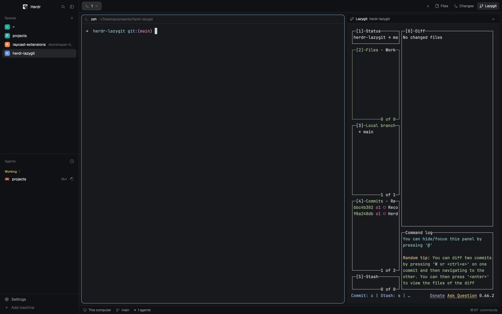

# Herdr Lazygit panel

A Lazygit button for the [Herdr desktop app](https://herdr.dev). It sits in the top bar, right after Herdr's own Files and Changes buttons. Clicking it opens the right-side panel with a live [lazygit](https://github.com/jesseduffield/lazygit) for the active space's git repo. The panel remembers, per space, whether Lazygit was open.



## Requirements

- Herdr desktop app for macOS (v0.1.11 tested)
- `lazygit` on your PATH (`brew install lazygit`)
- `git`, `python3` (used by `install.sh`), and `jq` (used by `uninstall.sh`)

## Install

```sh
git clone https://github.com/o101k/herdr-lazygit
cd herdr-lazygit
./install.sh
```

The install copies two mods into `~/.config/herdr-app` (or `$HERDR_APP_HOME`), builds the `lazygit` layout from your current `main` layout, checks the mods with `herdr-app check`, and switches Herdr to the `lazygit` layout. Switch back any time with `ctrl-shift-l`.

The install never overwrites anything it did not put there. If a target already exists and is not from this mod, it stops and tells you which path to move.

After a Herdr update, rerun `./install.sh`. It rebuilds the layout from Herdr's latest `main`.

## Use

1. Open a space on a git repo.
2. Click **Lazygit** in the top bar. The right panel opens with lazygit for that repo.
3. The bar above lazygit shows the repo name. The `↻` button restarts lazygit.

Each space and repo has its own lazygit, which keeps running when you switch spaces. When you quit lazygit (`q`), clicking the button again starts a new one. Pressing `q` while the panel shows lazygit also brings a new one back.

Switching spaces brings back each space's panel: Files, Changes, or Lazygit, as you left it. Lazygit is remembered per space by this mod. Files and Changes are remembered by Herdr.

If the space is not in a git repo, the bar says "Not a git repository" and no lazygit starts. Remote spaces (on another machine) show "Lazygit panel supports local spaces only".

## How it works

- **Herdr's own tab bar is used unchanged.** The layout puts Herdr's `tabs` block in a `tab-bar` row, followed by a `lazygit-button` block. Herdr's tab bar keeps updating with Herdr, and the button sits beside it as its own block.
- **`mods/lazygit-button`** draws the button, matched to Herdr's panel buttons. It opens and closes the Lazygit page of the panel. It remembers, per space, whether Lazygit was open, and reopens it after Herdr has restored that space's panel.
- **`mods/lazygit-panel`** is the controller. While the panel shows lazygit, it finds the repo with `git rev-parse --show-toplevel` and looks for a live core terminal labelled `herdr-lazygit.space` and `herdr-lazygit.repo`. If there is none, it starts `lazygit` with `hc run --bg` and those labels, then points the terminal block at it with `layout.set`. Terminals for spaces that no longer exist are killed.
- **`scripts/make-layout.py`** builds `layouts/lazygit.json` from a `main` layout. The reference copy in this repo was built from the `main` layout on the day it was committed.

When lazygit ends while the panel shows it (for example, `q` or `hc kill`), Herdr removes the terminal block and the panel column around it from the layout. The controller puts both back with `layout.set` and starts a new lazygit within a few seconds.

## Adding more buttons

Other mods' buttons go in the same `tab-bar` row, after `lazygit-button`. For example, a button from a mod called `issues-button`, 92 px wide:

```json
{ "id": "issues-button", "type": "block", "size": { "px": 92 }, "window_drag": true,
  "content": { "mod": "issues-button" } }
```

Add it to the `children` of `tab-bar`, after `lazygit-button`.

## Limitations

- The layout is built when you run `install.sh`. It is not kept in sync with Herdr's `main` between installs. Rerun `./install.sh` after a Herdr update.
- Local spaces only. Remote spaces are not supported.
- One lazygit per space and repo. Starts are limited to one per 3 seconds per space and repo, so a lazygit that exits at once (for example, if it is not installed) does not spawn in a loop.
- The Lazygit button's per-space memory lives in the button mod's browser storage. It survives restarts, but not a reinstall that clears the mod.

## Uninstall

```sh
./uninstall.sh
```

This switches Herdr back to `main`, ends the lazygit terminals the panel started, and removes the mod folders and the layout. It removes only files marked as installed by this mod. It also removes the `lazygit-tabs` mod from earlier versions, if it is one of ours.
