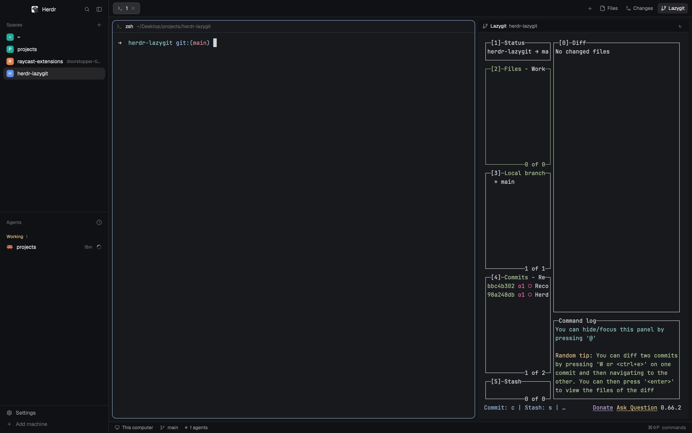

# Lazygit panel

A Lazygit button in the top bar, right after Herdr's Files and Changes buttons. Clicking it opens the right-side panel with a live lazygit terminal for the active space's git repo. A thin bar above the terminal shows the repo name and a restart button. The panel remembers, per space, whether Lazygit was open.

## What you see

- **Tab bar** (top, 42 px, Herdr's own `tabs` block, unchanged): the space's tabs on the left, then `+`, then Herdr's **Files** and **Changes** buttons, then this mod's **Lazygit** button. The button is a separate 92 px block on the same chrome background with the same bottom border. Its look matches Herdr's panel buttons: 26 px tall, 8 px side padding, 5 px gap, 14 px icon, 12 px text, `rounded(6)`. When the Lazygit page is open, it uses the `selected` background and `foreground` text. Otherwise it uses `chrome` and `muted`.
- **Main area**: the terminal of the active tab, as in Herdr's `main` layout.
- **Right panel** (520 px wide, hidden by default, 280 to 900 px): a 30 px bar on top, then a live lazygit terminal that fills the rest.
- **The bar**: a git-branch icon (14 px, `muted`), "Lazygit" in `foreground`, then the repo folder's name in `muted` at 12 px, then a 22 px `↻` button at the right.
- **Remote space**: the same as a local one, with the machine's name before the repo name ("vps: app").
- **Non-repo space**: the bar shows the same icon and label, then muted text: "Not a git repository: <folder>". The terminal area is empty.
- **Unreachable machine**: "Could not reach <machine>: <hc's message>" in `blocked`, and a `↻` that asks again. The terminal area is empty.

## How it behaves

- Clicking **Lazygit** opens the panel on its Lazygit page. Clicking it again while the page is open closes the panel.
- Opening the Lazygit page for a space runs `git rev-parse --show-toplevel` in that space's folder. The folder is the focused pane's folder if it is in this space, else the first pane's folder, else the space's folder.
- If the folder is in a repo and no live lazygit exists for that space and repo, the mod starts `lazygit` in the repo root. The bar then shows the repo name and the terminal shows lazygit's own UI (Status, Files, Branches, Commits, Stash).
- Switching spaces: Herdr's tab bar restores that space's panel (Files, Changes or Lazygit, or closed) in the same frame as the switch. The terminal block switches to that space's lazygit about 16 ms later, and at once from cache for any folder seen before. While a new folder is checked, the block shows this space's lazygit if it has one, and never another space's.
- Each space and repo keeps its own lazygit running.
- A remote space (`space.machine` set) runs git with `hc exec --on <machine>` and lazygit with `hc run --on <machine>`. Its folder falls back to that machine's home, never the local one.
- Quitting lazygit with `q` ends it. Pressing `q` while the panel shows lazygit brings a new one back within a few seconds. The bar stays on screen.
- Clicking `↻` kills the current lazygit and starts a fresh one. The button does nothing while a start is in progress.
- Closing a space kills its lazygit the next time the panel is shown.
- Nothing else in the window changes: other spaces, tabs and terminals are untouched.

## Built from

- **Layout `lazygit`** (`layouts/lazygit.json`, generated by `scripts/make-layout.py` from Herdr's `main` layout): Herdr's `tabs` block is kept exactly, minus its size, in a new `tab-bar` row with a `lazygit-button` block (92 px, `window_drag`, mod `lazygit-button`). The `panel` column is at least 520 px. The `panel-body` stack gets a third child, `lazygit`: a column with a 30 px block (`lazygit-bar`, mod `lazygit-panel`) and a hidden block (`lazygit-term`) with content `{ "terminal": "none" }` that the controller fills.
- **Mod `lazygit-button`**: draws the button. It reads `layout()` for `panel` and `panel-body`. It opens the page with `layout.select {stack: "panel-body", child: "lazygit"}` and `layout.show {id: "panel"}`, and closes it with `layout.hide {id: "panel"}`. It adds `"lazygit"` to `shared("workspace.panels")` when that list lacks it (unset counts as `["files", "changes"]`), so Herdr's tab bar remembers and restores the page per space. Icon: `lazygit.svg`, a Lucide-style git-branch in 24x24 with `currentColor` strokes.
- **Mod `lazygit-panel`** (controller): uses `spaces()`, `focused()`, `panes()`, `layout()`, `terminals()`, `shared("layout")`, `theme()`, `exec("git")`, `exec("hc")` and `run("layout.set")`. It caches `git rev-parse` results per folder.
- **Commands and programs**: `git rev-parse --show-toplevel`; `hc run --bg --json --no-parent --cwd <root> --label herdr-lazygit.space=<id> --label herdr-lazygit.repo=<root> -- lazygit`; `hc kill`, `hc rm`. For a remote space: `hc exec --on <m> --cwd <folder> -- sh -c '… exec "$@"' sh git rev-parse --show-toplevel`, the same `hc run` with `--on <m>`, `hc get <m>/<t> --json` to check a terminal is live, and `hc exec --on <m> -- sh -c '… hc ls --json --label …'` to find one by labels.
- **Herdr's own mods used unchanged**: `tabs` (the tab bar), `files` and `changes` (the panel pages), `mods/pane/close.svg` and `mods/workspace-chrome/spinner.svg` (from Herdr's `tabs` mod).

## Watch out

- **Herdr drops the terminal block when its terminal ends while shown**, along with the `panel` column around the stack (the stack moves up and keeps its 520 px). Find nodes by id and rebuild them when missing. Don't require `panel` to exist before showing lazygit.
- **Herdr's `tabs` mod restores only the pages in `workspace.panels`.** It records any `panel-body` child per space, but on a switch it treats a child that isn't listed as closed. Adding `"lazygit"` to the list makes it restore Lazygit too, in the same frame. It draws buttons only for `files` and `changes`, so no second button appears. Don't re-add a timer that reopens the page after the switch: that is the visible close-then-reopen.
- **`layout.set` replaces the whole tree.** A tree read in the frame of a space switch is from before the tab bar's restore landed, and writing it undoes the restore. Defer the terminal write a moment (16 ms), re-read `layout()`, and drop it if the space changed or the panel no longer shows Lazygit. Never `cx.notify()` from that timer: it would loop.
- **Don't add `herdr.space` or `herdr.tab` labels** to the lazygit terminal. Those make it a normal tab. Use only the `herdr-lazygit.*` labels.
- **Write the layout only when it changes.** The terminal block's address is written with `layout.set`, and only when the node differs from what is wanted. Writing on every render makes a loop.
- **Check for the shared layout name**: the controller writes the layout only when `shared("layout") === "lazygit"`. Do not write another layout.
- **A start can fail silently**: if `lazygit` is not on PATH, the terminal exits at once. The controller retries at most once every 3 seconds. The bar shows the error only when `hc` itself fails.
- **Only append to `shared("workspace.panels")`.** That is Herdr's setting, also edited by the welcome. Add `"lazygit"` when missing, keep the rest as it is, and write only when it changes.
- **Keep `herdr-app check` passing** for both mods after any edit.
- **Use `git -C <folder>`**, not `cd`: `exec` runs in the app's environment and the folder can change while the mod runs.
- **Don't make the bar draw a timer**: nothing polls. Everything reacts in `render`, apart from the one-shot terminal-write and retry timers.
- **The app may not list other machines' terminals in `terminals()`.** For a remote address it doesn't list, ask `hc get <m>/<t>`, and only when the block is not showing it, at most once per 3 seconds. Never poll while it is shown: when it ends, the app drops the block, and that render asks again.
- **hc prints its own errors as JSON on stderr** (`{"error":{"kind","message"}}`), for `hc run` and `hc exec` alike.
- **Remote commands get a bare system PATH**, without `~/.local/bin`. Start remote lazygit (and hc) through `sh -c 'PATH="$HOME/.local/bin:$PATH" exec "$@"'`. `spawn_failed` from `hc exec --cwd` means the folder is gone: treat it as "not a repo", not as an unreachable machine.
- **`hc ls --json` doesn't print labels.** Read them with `hc get <t> --json`, or filter with `hc ls --label k=v`.

## Done when

- `herdr-app check` passes for `mods/lazygit-button` and `mods/lazygit-panel`, and `herdr-app status` shows `"errors": []` after the layout is switched to `lazygit`. Neither mod has a `*.error` file.
- The tab bar shows Herdr's Files and Changes followed by Lazygit, all on the same background with the same bottom border.
- Clicking Lazygit opens the right panel with lazygit's Status, Files, Branches and Commits boxes. Clicking it again closes the panel.
- For a space in a git repo, `hc ls --all --json --label herdr-lazygit.space=<id>` shows exactly one live lazygit terminal, and it stays one after 5 seconds.
- After `hc kill` of the panel's lazygit, within about 5 seconds a new live lazygit with the same labels is shown in the panel. Repeating the kill recovers again, and there is never more than one live lazygit for that space.
- With two spaces, A (Lazygit open) and B (Files open): switching A → B → A shows Lazygit in A, and switching back to B shows Files in B. Closing the panel in B and switching to A shows Lazygit, and switching back to B shows it closed.
- No flicker: `herdr-app shot` taken 50 ms after a switch already shows the target space's panel state and, for Lazygit, that space's own lazygit. Rapid A → B → A → B → A switches end on A's lazygit.
- For a remote space on a repo, the bar reads "<machine>: <repo>", lazygit shows that machine's repo, and `hc get <m>/<t> --json` shows it live with the `herdr-lazygit.*` labels. Killing it brings a new one back, as for a local space. With the machine unreachable, the bar reads "Could not reach <machine>" and `↻` asks again.
- For a space on `/tmp`, the bar reads "Not a git repository: /private/tmp" and no lazygit terminal exists for that space.
